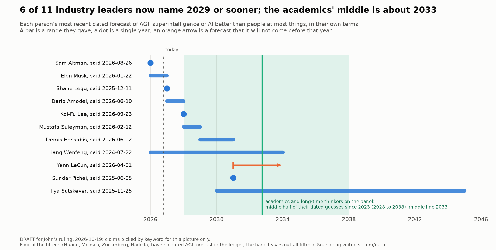
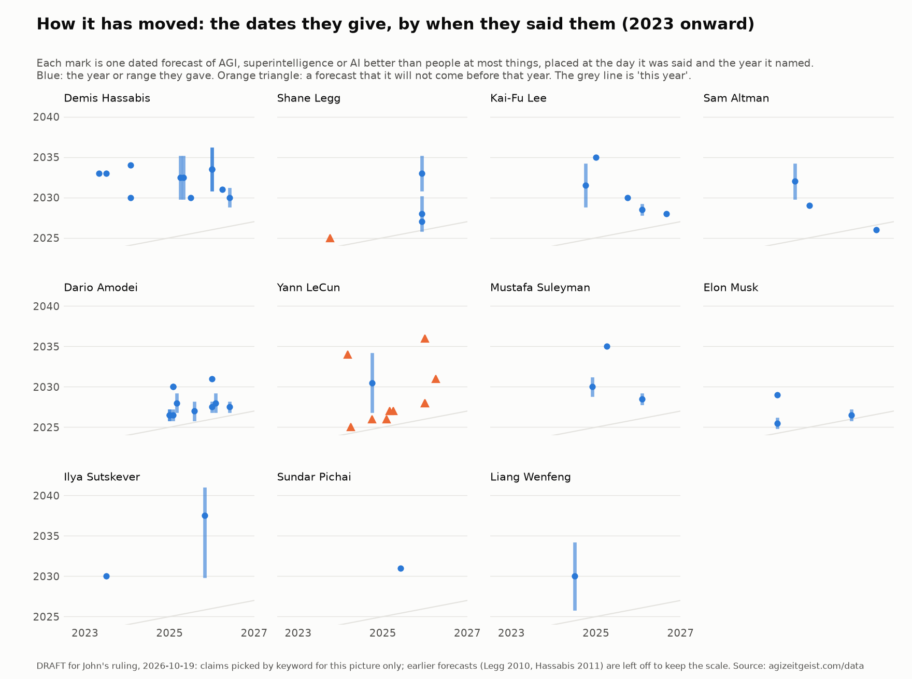

# Two voices of one zeitgeist: reframing the claims ledger

**Status: ruled 2026-10-19.** John agreed the remaining choices ("Agreed on all", to the master
session's recommendations): the page leads with AGI forecasts against the academics' band, and
undated words are let in as words only (the alternative in choice 2 below, not the first
recommendation). Amendment A31 records the decision. John answered the Huang question (choice 3)
separately, "Yes", to the recommendation. This file is kept as the record of what was proposed; the method and the page are
built from A31.

## John's rulings, 2026-10-19

All three were given in his words and relayed by the master session.

1. **What the ledger is for.** "The goal is not to score people on their success at
   predicting the future, the goal is to track the zeitgeist of what these people are saying
   to get a feel for what the vanguard of the industry is predicting at any given time."
2. **What the tracker is for.** "The goal is to make a tracker of the Zeitgeist around AGI and
   the Singularity. We need to track both the traditional academics who have been talking about
   this for decades as well as the new industry leaders who are actually making it happen but
   tend to run way out in front of their skis with their predictions. Both of these are valuable
   for the Zeitgeist though."
3. **Verdicts.** "Sure, we can keep the verdicts as small notes, but they are not the point of
   the tracker." So each claim keeps a small note saying whether its date has passed and what
   happened. Verdicts appear in no headline, summary, count, chart title or share post, and
   there are no per-person hit rates.

## The change in one paragraph

The tracker follows two voices of one zeitgeist. One is the academics and long-time thinkers who
have talked about AGI and the singularity for decades: the members of the frozen expert panel
who have never worked at a company building frontier AI, read through their coded statements. The other is the industry's leaders, who are building it and whose dates tend
to run ahead: the claims ledger, fifteen people, read through their dated predictions. Both are
valuable, and neither is a scorecard. The site shows what each group says now, how far apart
they are, and how both have moved. The home page's frontier-voices chart already does this for
the panel. The claims page becomes the industry's half, in the same spirit.

## 1. The purpose, as the pages would state it

**The claims page, at the top** (and the method, "What this ledger is for"):

> **What the industry's leaders predict.** This is a dated record of what the people who lead
> the companies building frontier AI say the future holds: when they expect AI to match or pass
> people, and what they expect it to do along the way. Each prediction is in their own words,
> with the date, the occasion and a link to the source. It is one of the tracker's two voices,
> beside the academics and long-time thinkers on the home page, and it is read the same way:
> for what they are predicting now and how that has shifted. It is not a scorecard. Where a
> prediction's date has passed, a small note says what happened.

**The home page, opening its zeitgeist section** (draft on this branch, in `scripts/site.py`):

> This part of the site follows two voices. One is the academics and long-time thinkers who
> have written about AGI and the singularity for decades. The other is the people now running
> the companies that build it, whose dates tend to run ahead of everyone else's. Both are part
> of the mood of the time, and the site keeps both, says what each is saying now, how far apart
> they are, and how both have moved. Neither is scored.

**The method page** (`docs/methodology-v2.md`) gets a short section 0, "What the tracker is
for", quoting John's second ruling and naming the two voices and where each lives in the data.

## 2. The claims page, from top to bottom

**First, what the industry's leaders say now, against the academics.** For each person, their
most recent dated forecast of AGI, superintelligence or AI better than people at most things,
on one shared timeline, in their own term (each means something different by it). Behind them,
a shaded band for the academics and long-time thinkers on the panel: the middle half of their
dated guesses since 2023, from the same rows as the home page's frontier-voices chart, taking the
panel members not tagged as builders and leaving out all fifteen industry leaders (see choice 3). So the
gap between the two voices is visible at a glance. Beside each leader, their latest dated
prediction of any kind, so the four who have never named a year for AGI (Jensen Huang, Arthur
Mensch, Mark Zuckerberg and Satya Nadella) still have a current view on the page.

The title is computed, so it stays true as forecasts are added. On today's record: six of the
eleven leaders who name a year now say 2029 or sooner, and the academics' middle year is about
2033 (the middle half of their 26 dated guesses since 2023 runs from 2028 to 2038). Two cautions come straight from the record. Sam
Altman's latest forecast (an internal system he would call AGI by the end of 2026) comes from
news reports, not his own words, and the page would mark it so. Liang Wenfeng's latest is from
July 2024, and the page would show its age.

**Second, how the leaders' dates have moved.** The same forecasts placed by the day they were
said and the year they named, one small panel per person: who has moved their date nearer, who
has held it, who has pushed it back. Under it, a link to the frontier-voices chart, which shows
the same for the panel. The two stay separate charts: the frontier-voices chart is drawn from
the panel's statements, which the three people on the ledger-only list never enter (amendment
A30).

Both pictures are drafts. Their forecasts were picked by keyword for this proposal
(`claims-ledger-reframe-2026-10-19/tag_draft.py` and `draw_draft.py`); the built page would
use a field entered by hand on each claim (section 4).

**Third, every claim, by person, in date order.** The words, the date, the occasion, the source
and the test, as now. The verdict becomes a small grey note at the end. For example: "Its date
passed on 2020-12-31; there were not a million robotaxis on the road." Or: "Its date has not
come." Or: "It names nothing an outsider could check." The coloured status chips go, and so does
the table of counts per person.

## 3. Where verdicts stop appearing (John's third ruling)

| Place | Now | Proposed |
|---|---|---|
| The claims page's opening and tables | Counts of due, came true, did not, per person and in total | Gone; a small note on each claim only |
| The home page | "Of the 325 predictions ... 108 are now due, and 36 came true." | A sentence about the present, computed from the "now" figure: on today's record, "Six of the eleven industry leaders who name a year for AGI now say 2029 or sooner; the academics and long-time thinkers on the panel put the middle of their guesses at about 2033." Until the new field is entered, the draft on this branch uses a count-free sentence pointing to the claims page |
| `site/status.json`, the `claims_ledger` block | Counts of claims, due, came true, did not, cannot be tested | The number of claims and of people only, plus a `now` block (each leader's latest forecast); no verdict counts. Nothing outside this site reads those counts today (checked 2026-10-19: the blog's projects page does not) |
| The downloadable table, `data/claims.csv` | One row per claim, with its status | Unchanged: the status is the claim's own note, not a count |
| Chart titles and share posts | None yet | Never |
| Per-person hit rates | Planned once each person's search is done | Dropped, with their floor of five and the "seed only: not a rate" label |

The checking already done is kept. It is what makes each claim trustworthy as a record of what
was said, and each note true.

## 4. What the record needs

One new field on each timing claim, entered by hand: **what arrives**, in the person's own term
(AGI, superintelligence, AI better than people at most things, or something else). The rest is
already recorded: whether the forecast is a year, a range (`due_early` to `due`), or a forecast
that something will not come before a date. About 84 timing claims need the field, checked by a
second reader; the validator would refuse a timing claim without it.

The year-by-year searches stay, with a new purpose: they make the "now" view complete, so a
person's latest forecast is really their latest. They start from each person's most recent year
and work back.

## 5. What does not change

Who is in the ledger and why (A30); the admission rule; the five status words and what counts
as a hit, now used for the notes; John's readings of 2026-10-19; and everything the ledger must
never touch (the frozen panel, the coded statements, the scored series, the thresholds, the
definition, the singularity verdict and the headline).

## 6. The three choices still open for John

**1. What leads the claims page: AGI forecasts, or the latest of everything?**
- **Recommended: AGI forecasts lead**, against the academics' band, with each leader's latest
  prediction of any kind beside them. It is the one question both voices answer, so it is where
  the gap between them shows.
- **The alternative:** lead with each leader's latest dated prediction of any kind (products,
  robots, jobs, medicine), with the AGI dates second. Broader, but it cannot be set against the
  academics.

**2. Undated predictions ("AGI is close"): keep them out, or let them in?**
- **Recommended: keep them out.** The ledger stays a record of dated predictions, so every mark
  on its charts sits at a year someone named, as on the home page. The panel's undated talk is
  already in the coded statements, and twelve of the fifteen leaders are on the panel.
- **The alternative:** admit undated predictions by the fifteen as their own kind of row, shown
  as words only in the "now" section, never on a chart. It would catch the mood of the moment
  better, especially for the three leaders who are not on the panel.

**3. Jensen Huang on the home page's frontier-voices chart.** That chart splits the panel by a
builder tag that John left off Huang when the panel was frozen (amendment A18), so his three
dated guesses since 2023 (2026, 2028 and 2029) are drawn among "the people who study it". Under
the two-voices framing he is plainly one of the industry's leaders.
- **Recommended: draw all fifteen industry leaders on the builders' side of that chart**, by
  reading the ledger's list for the chart only. The frozen tag itself stays as it is. It moves
  three dots, and the chart's title is computed, so it stays true.
- **The alternative:** leave the chart as frozen, and leave the fifteen out of the academics'
  band on the claims page only (as the draft picture already does).

## 7. What happens next

Once John rules on the three choices: amendment A31 as ruled; the method and home-page wording as
on this branch; the new field entered on every timing claim and checked by a second reader; the
claims page and the status file rebuilt; and the news post reframed by the session that drafted
the story version, then put to John before it goes up. The share task stays on hold until then.
