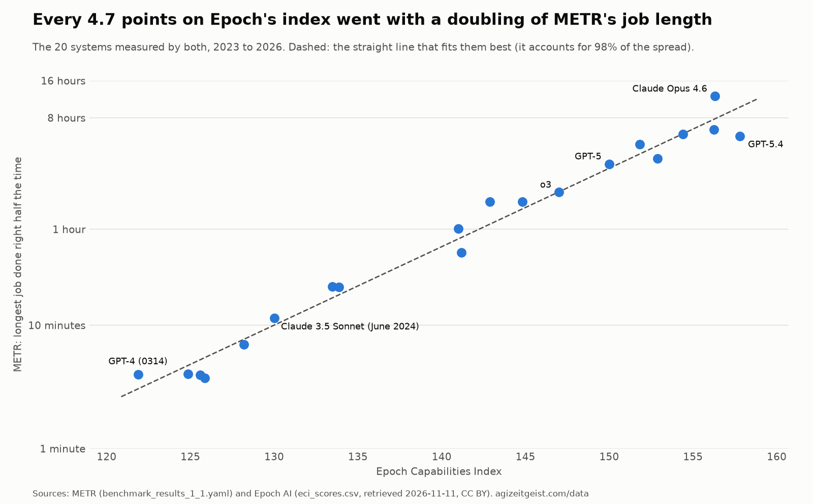
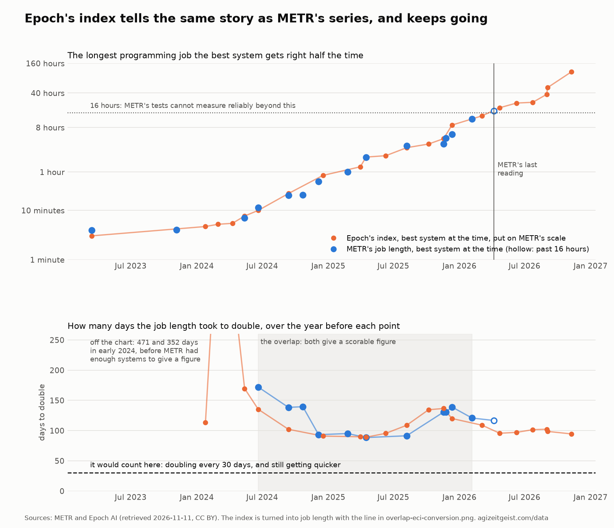
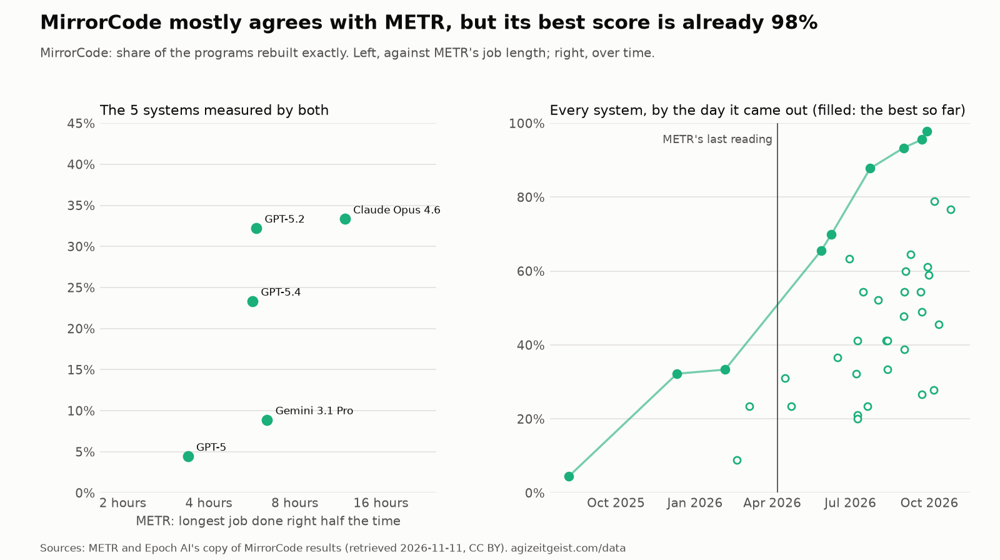
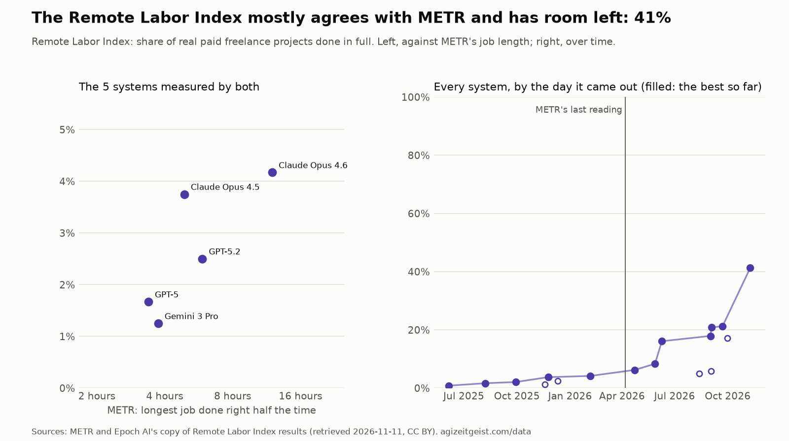

# Proposal: what replaces METR's series in the pace part

*Written 2026-11-11 by a working session, on the standing instruction in amendment A24, the open
question of what replaces METR's series ([the changelog](amendments.md)): on METR's answer, or by 2026-11-14 without one, propose
successor series for the pace part with pictures of the overlap. Nothing scored changes with this
document. The thresholds file, the scored rows, the definition and the live site are untouched.
The lean in section 7 is the session's and is not my ruling; changing the gauge is my decision,
and the question I have to answer is in section 8.*

## 1. The short version

- **METR has not answered.** My note of 2026-10-17 has had no reply in 25 days.
- **METR's own pages name no successor.** The series is still marked as no longer updated, and
  METR's newer reports measure progress with other people's numbers, chiefly an index published
  by [Epoch AI](https://epoch.ai/).
- **Three candidate series were checked against METR's**, each with a picture of the stretch
  where both exist. One of them, the
  [Epoch Capabilities Index](https://epoch.ai/eci), follows METR's series closely over 20 shared
  systems and keeps going. The other two agree with METR in direction but cannot fill the gauge's
  formula.
- **If the pace part switched to Epoch's index today, it would read about 59% of the way instead
  of 43%**, and the headline average would move from 32% to about 37%. The slowest part, the
  economy, would still be at 0%, and the answer would still be "Not yet."

## 2. Did METR answer?

No. What was checked on 2026-11-11:

- **My mail.** The note I sent to info@metr.org on 2026-10-17 ("Is a successor to the Time
  Horizon 1.1 series planned?") is a thread of one message. A search of all mail since
  2026-10-16, trash included, for anything from metr.org or mentioning the time horizon found
  only that note and a Reddit notification about a reader's comment on the tracker.
- **The repository.** Amendment A24 is still open, and no later entry in the changelog records a
  reply.
- **The worklog.** No entry in the AGI Zeitgeist project since 2026-10-17 records a reply.

The wait named in the task ends on 2026-11-14. I am away on 12 and 13 November, so the proposal
is drafted now. If METR writes before I rule, their answer comes first.

## 3. What METR publishes now

Each page below was opened and read on 2026-11-11.

- **[METR's time-horizons page](https://metr.org/time-horizons/)** still says it is no longer
  actively updated, and its last entry in its own list of updates is 2026-09-08. "Time Horizon
  1.1" is still labelled the current version. There is no 1.2 or 2.0, and no mention of one. The
  page still carries the warning that measurements above 16 hours are unreliable with the present
  set of tasks. The [results file](https://metr.org/assets/benchmark_results_1_1.yaml) holds the
  same 26 systems the tracker already has, ending with an early preview of Claude Mythos dated
  2026-04-07.
- **[METR's Frontier Risk Report](https://metr.org/blog/2026-05-19-frontier-risk-report/)**
  (2026-05-19) says the strongest systems had all but used up the Time Horizon 1.1 tasks, and
  that cheating made the longest tasks hard to score: on tasks longer than eight hours, at least
  16% of the runs that looked successful were thrown out on review.
- **[METR's summary of its evaluation of GPT-5.6 Sol](https://metr.org/blog/2026-06-26-gpt-5-6-sol/)**
  (2026-06-26) is the most recent report I found in which METR tried the measure on a new
  system. It gives three
  different answers, from about 11 hours to more than 270 hours, depending on how cheating
  attempts are counted, and says none of them is a sound measurement.
- **[METR's summary of its evaluation of Claude Opus 5.5](https://metr.org/blog/2026-09-22-claude-opus-5-5/)**
  (2026-09-22) does not report a time horizon at all. It rests on five tasks and on
  the trend in a capabilities index reported by the system's maker.
- **[METR's outline of how an assessor could check for acceleration](https://metr.org/blog/2026-10-14-ai-rd-acceleration-assessment-proposal/)**
  (2026-10-14) asks companies for scores on many tests so that the Epoch Capabilities Index and
  similar measures can be worked out. It does not ask for time horizons.
- **[METR's post on MirrorCode](https://metr.org/blog/2026-04-10-mirrorcode-preliminary-results/)**
  (2026-04-10) points to a test of very long programming jobs that METR paid for and built
  together with Epoch AI. The Frontier Risk Report used an early version of it beside the time
  horizon.

Read together: METR has stopped extending the time-horizon series, has not announced a
replacement for it, and in its own recent work leans on Epoch's index and on MirrorCode. That is
not a statement from METR that either one is the successor, and this document does not treat it
as one.

## 4. How the pace part reads METR's series today

The pace part asks whether the growth in what AI can do is itself speeding up. Its measure is
METR's "50% time horizon": the longest programming job, counted in the time a skilled person
needs for it, that a system gets right half the time. The rules are in
[the definition](singularity-entry-definition.md), section 2, and the frozen numbers are in
`docs/singularity-entry-thresholds.json`.

1. Take only the systems that were the best on the day they came out.
2. For each of them, fit a line through the best systems of the twelve months before it (three
   or more are needed). The slope gives the number of days the job length took to double.
3. Skip any twelve months that include a reading past 16 hours, because METR says its tasks
   cannot measure reliably beyond that.
4. The gauge is how far the latest doubling time has come from the reference pace, 187.8 days
   (METR's own fit over 2019 to early 2026), towards the line, 30.44 days.

Today that gives a doubling time of 120.8 days over the year to 2026-02-05, which is 43% of the
way. The only later figure (116.8 days, the year to 2026-04-07) includes the reading past 16
hours and is not scored. No newer reading is coming, so the gauge now shows a figure that is nine
months old and cannot change.

The rule for replacing the series was written on 2026-10-08, before the series stopped: a
replacement is named, the stretch where old and new overlap is published, and the switch is a
dated amendment. One part of that rule can no longer be met as written. It says the replacement
is named before the old series stops, and the series had already stopped when the first weekly
reading noticed on 2026-10-16.

## 5. The candidates

The numbers in this section come from `scripts/leg_a_successor.py`, which reads the tracker's
METR rows and dated copies of three files downloaded from
[Epoch AI's data page](https://epoch.ai/benchmarks/use-this-data) on 2026-11-11. Epoch publishes
them under the
[Creative Commons Attribution licence](https://creativecommons.org/licenses/by/4.0/). The copies,
the tables and the pictures are in `docs/leg-a-successor-2026-11-11/`.

| | Epoch Capabilities Index | MirrorCode | Remote Labor Index |
|---|---|---|---|
| What it measures | one score for how capable a system is, worked out from its results on 57 different tests | the share of whole programs a system can rebuild exactly, working alone for up to a week | the share of real paid freelance projects a system completes in full |
| Who publishes it | Epoch AI | Epoch AI, built with METR | the Center for AI Safety and Scale AI; Epoch carries a copy |
| How far back | systems released from February 2023 | systems released from August 2025 | systems released from June 2025 |
| Newest system in the file | 2026-11-09 | 2026-10-26 | 2026-11-09 |
| Systems also in METR's series | 20 | 5 | 5 |
| Can it give a doubling time? | yes, once tied to METR's scale | no | only loosely |
| Room left | no top to the scale | almost none: best score 98% | some: best score 41% |
| Pace part would read | 59% (43% today) | cannot be scored | not proposed for scoring |

### Candidate 1: the Epoch Capabilities Index, tied to METR's scale

**What it is.** The [Epoch Capabilities Index](https://epoch.ai/eci) gives each AI system one
number for how capable it is. Epoch works it out from the system's results on many tests at
once, 57 in the file used here, giving more weight to harder tests. It was built so that
comparisons still work after any single test has been maxed out, which is the problem METR's
series has run into. [Epoch's own notes on the index](https://epoch.ai/data/eci-documentation)
say the numbers have no meaning alone and only differences between systems count.

**Who publishes it, how far back, how often.** Epoch AI, a research group that collects data on
AI. The file holds 255 systems, the oldest released in February 2023. The download was dated the
day it was fetched, and its newest system came out two days earlier, so it is being kept current.
Epoch works the whole index out again when new results arrive, so past values shift a
little; its
[note on the latest method change](https://epoch.ai/publications/eci-bayesian-methodology)
(2026-11-04) says the best systems moved by about one point.

**How it lines up with METR.** Twenty systems have both a METR job length and an Epoch index
number, from GPT-4 (March 2023) to GPT-5.4 (March 2026). Across them, a straight line fits
closely: every 4.7 points on the index went with one doubling of METR's job length, and that
line accounts for 98% of the spread. Epoch's own page says roughly the same thing, that about 5
points went with one doubling when the index was launched.

That line is what ties the index to METR's scale. With it, a rise in the index over a year
becomes a number of doublings, and so a doubling time in days, which is what the gauge's formula
needs. The reference pace (187.8 days) and the line (30.44 days) stay exactly as they are.

**Do the two tell the same story?** Over the stretch where METR gives a scorable figure (the
years ending June 2024 to February 2026), yes:

- Both start slow in mid-2024, quicken to about 90 days through early 2025, slow to about 135
  days in late 2025, and quicken again.
- Averaged over METR's eleven scorable figures, METR gives 122 days and the index gives 113.
  Figure by figure, the index runs from 27% quicker to 19% slower than METR.
- At METR's last scorable figure they agree almost exactly: METR 120.8 days, the index 120.0.
  Both come to 43% of the way.

**How it would change the reading.** The index's latest figure covers the year to 2026-11-09 and
nine best-at-the-time systems: 18.3 points a year, which is a doubling every 94.5 days, or 59% of
the way. The rules also ask for the doubling time to have got quicker three figures running.
Under METR today it has not; under the index it has (102, 99, then 95 days). The headline would
move from 32% to about 37% (the average of 59%, 52% and 0%), and the on-current-trends sentence
would be worked out afresh by the site's script.

**What to be careful about.**

- **The index is not a job length.** It is a summary of test scores, expressed on METR's scale
  through one fitted number. Past April 2026 the top picture's orange line is a translation, not
  a measurement: no one timed a 120-hour job.
- **The fitted number moves the reading.** Fitted on all 20 systems it is 4.74 points per
  doubling. Fitted only on the 11 systems released since 2025 it is 5.76, and Epoch's round
  figure is 5. Those give 59%, 46% and 56% of the way. Whichever is chosen has to be frozen on
  the day of the switch and not refitted afterwards, or the gauge could be moved by re-drawing
  the line.
- **Part of the agreement is built in.** METR's results are one of the 57 tests that feed the
  index (33 of its 2,787 score rows), so the two are not fully independent.
- **Past values shift** when Epoch works the index out again. The tracker would keep a dated copy of the file each
  time it scores.
- **Two figures can land days apart** (1 and 3 September 2026), so "quicker three figures
  running" can be met within one week. The same is true under METR today.
- **The newest point is two days old** and has a wide range (170 to 179). Without it the reading
  is 99 days, 57%.

### Candidate 2: MirrorCode

**What it is.** [MirrorCode](https://epoch.ai/benchmarks/mirrorcode) asks a system to rebuild an
entire existing program from scratch, without seeing its source code, so that its output matches
the original exactly on hidden checks. Epoch's page says the largest of these would take a human
engineer weeks to months. The score is the share of 15 programs rebuilt perfectly. It is the
nearest thing in spirit to METR's measure, a test of very long jobs done alone, and METR helped
build it.

**Who publishes it, how far back, how often.** Epoch AI, which calls its results table regularly
updated. The file holds 39 systems released from August 2025 to 2026-10-26; Epoch lists the test
as released on 2026-06-26.

**Do the two tell the same story?** Loosely. Five systems are in both. Taking them two at a
time, MirrorCode and METR agree on which is stronger in 8 of 10 pairs. Five points is too few to
say more.

**How it would change the reading.** It cannot be scored as it is published. The gauge needs a
job length that can keep doubling, and MirrorCode gives a share that stops at 100%. The best
score went from 4% (August 2025) to 98% (September 2026), so the test is nearly used up within
five months of its release. METR's Frontier Risk Report did work out job lengths on an early
version and found them several times longer than on its own tasks, with a similar or slightly
quicker doubling time, but no series of those figures is published.

### Candidate 3: the Remote Labor Index

**What it is.** The [Remote Labor Index](https://www.remotelabor.ai/) is a set of real freelance
projects that people were paid to do, in fields such as game development, product design,
architecture, data analysis and video animation. Its makers say the projects add up to more than
6,000 hours of work. The score is the share of projects a system completes in full. Unlike METR's
tasks it is not limited to programming, and the work was not written to be easy to mark.

**Who publishes it, how far back, how often.** The
[Center for AI Safety](https://safe.ai/) and [Scale AI](https://scale.com/), with results on the
[Center for AI Safety's dashboard](https://dashboard.safe.ai/);
[Epoch carries a copy](https://epoch.ai/benchmarks/rli), which is the file used here. It holds 17
systems released from June 2025 to 2026-11-09; Epoch lists the test as released on 2025-10-29.

**Do the two tell the same story?** In direction, yes. Five systems are in both, and the two
measures agree on which is stronger in 8 of 10 pairs. The best score rose from under 1% (June
2025) to 41% (November 2026).

**How it would change the reading.** It is not proposed for scoring. A share of projects is a
different kind of number from a job length. The share itself has been doubling about every 100
days over the last year, which is close to the 95 days the index gives, but a share can double
only a little more than once from 41% before it reaches 100%. It would also change what the pace
part means, from "how long a job" to "how much real paid work", which overlaps with the economy
part.

## 6. Looked at and set aside

- **METR's stricter measure in the same file** (the longest job a system gets right 80% of the
  time, not half the time). It has room left, since the top reading is about three hours. But it
  is the same stopped series, so it solves nothing.
- **Epoch's software-only version of its index.** It would sit closer to METR's programming
  tasks, but
  [Epoch's notes on it](https://epoch.ai/data/eci-documentation/domain-specific-eci) say it is
  scaled to rise at the same pace as the general index and cannot be used to judge long-term
  trends.
- **METR's newer measures** (how much money an AI can usefully spend improving a program before
  a person would do better, and studies of how much AI speeds up researchers). These are methods
  with one or two worked examples each, not series.
- **Leaving the gauge as it is.** This is the real alternative, and it is set out in section 7.

## 7. The session's lean (not a ruling)

**Lean: switch the pace part to the Epoch Capabilities Index, tied to METR's scale by the
fitted line, and show MirrorCode and the Remote Labor Index beside it, unscored.** Confidence:
moderate.

The reasons:

1. It is the only candidate that can fill the formula without changing the line or the
   reference pace, so the switch cannot move the goalposts.
2. The overlap is long (20 shared systems, eleven scorable figures over 20 months) and the two
   series rise and fall together and agree at the join.
3. It has no top to its scale and is kept current, so the same problem should not come back
   soon.
4. METR's own recent reports use it for the question the pace part asks.

How the session would do it, if I say yes:

- **Join date.** METR's figures stay as scored up to the year ending 2026-02-05. The index
  supplies every figure after that.
- **The fitted number** is frozen at 4.74 points per doubling, from the 20 shared systems as
  they stood on 2026-11-11, and never refitted. The page says plainly that it is a translation.
- **A dated copy** of Epoch's file is kept each time the gauge is scored, because Epoch revises
  past values.
- **The two unscored series** are printed beside the pace part as a cross-check, the way
  Anthropic's merged-code figure sits beside the part on AI doing the research.
- **If METR, or anyone, later publishes a new job-length series** with an overlap, the question
  is opened again under the same rule.

**The strongest alternative: change nothing, and say the pace part is no longer measured.** The
gauge would keep its last figure (43%, the year to February 2026), marked as frozen, or drop out
of the headline average the way the forecasts part does. The case for it: the index is a
summary of test scores and not a job length; tying it to METR's scale rests on one number the
tracker chose; and the rule said the replacement would be named before the series stopped, which
did not happen. Choosing a replacement after seeing that it reads higher (59% against 43%) is
the kind of move the rule was written to prevent. The case against: a part frozen in February
says less every month, and the overlap shows the higher reading comes from nine more months of
data, not from the switch. At the join the two agree at 43%.

## 8. The question for me

**Does the pace part switch to the Epoch Capabilities Index, tied to METR's scale at the
overlap, or does it stay frozen at METR's last scorable figure and say so?**

If the answer is "switch", two smaller choices have defaults in section 7 that I can accept or
change: the fitted number (4.74 as fitted, or Epoch's round 5), and whether the two unscored
series are shown beside the part.

## 9. What a "switch" ruling would change (none of it done here)

- A new numbered amendment in the changelog (the next free number is A37), closing A24.
- `docs/singularity-entry-thresholds.json`: the pace part's anchor, its rows, the join date and
  the frozen fitted number.
- `data/world_measures.csv`: rows for the index's best-at-the-time systems, each with its
  source, and the dated copy of Epoch's file.
- `scripts/site.py`: the pace part's scoring and its two charts; the home page's paragraph on
  the pace part.
- Section 2 of the definition, and the weekly reading's instructions, which would fetch Epoch's
  file every Monday.
- The forecasts part's ledger uses METR's series as its reference too and would need the same
  look.

## 10. Sources, and how to redo this

- METR: [the time-horizons page](https://metr.org/time-horizons/), its
  [results file](https://metr.org/assets/benchmark_results_1_1.yaml), and the reports linked in
  section 3. All read on 2026-11-11.
- Epoch AI: the [index](https://epoch.ai/eci), its
  [notes](https://epoch.ai/data/eci-documentation), the
  [data page](https://epoch.ai/benchmarks/use-this-data) and the
  [MirrorCode page](https://epoch.ai/benchmarks/mirrorcode). Files retrieved 2026-11-11 and
  saved as `epoch-eci-scores-2026-11-11.csv`, `epoch-mirrorcode-2026-11-11.csv` and
  `epoch-remote-labor-index-2026-11-11.csv` in `docs/leg-a-successor-2026-11-11/`. Credit: Epoch
  AI, "Capabilities & benchmarking", epoch.ai/benchmarks, CC BY 4.0.
- The Remote Labor Index: [its own page](https://www.remotelabor.ai/), read 2026-11-11.
- The numbers: `overlap-numbers.json`, `eci-overlap-models.csv` (the 20 shared systems) and
  `eci-doubling-time.csv` (every figure the index gives) in the same folder.
- To redo it: `.venv/bin/python scripts/leg_a_successor.py`. The script first checks that it
  reads METR's series exactly as the site does (its doubling times must match
  `site/leg-a-doubling-time.csv`), then writes the pictures and tables. It writes nothing
  outside that folder.
