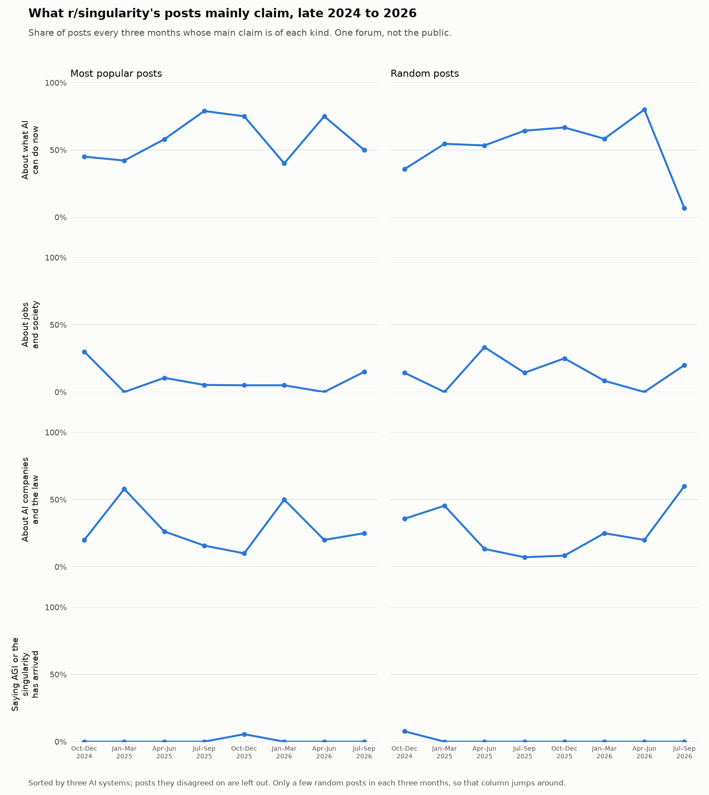

# Pilot report: r/singularity, vanguard sub-series, 2024Q4 to 2026Q3

**Model-coded, no human coder.** Updated 2026-10-09: five more top posts from the ranked reserve
were coded by all three models, so every quarter now has 20 eligible top posts (run record,
2026-10-09). Updated 2026-10-08: the figure and the results now come from the majority codes
of the full-sample run (all 390 posts, three models, final codebook).
Updated 2026-10-04 with Gemini's trial results (all three models complete on both trials).
Updated 2026-10-03 after John's rulings: first on the first version of this report, then on
the reliability design, which he revised twice that day. Coding is fully model-based
(amendment section 9; log entries of 2026-10-03). Run record:
`docs/vanguard/pilot-run-r-singularity-2026-10.md`; codebook: `docs/vanguard/codebook.md`.

**How coding was checked.** Three models from different companies each coded all 395
screened posts blind (the 390 of the full-sample run and 5 reserve posts added 2026-10-09), under the final codebook (rules adopted 2026-10-03: R2, telling company and policy news apart
from capability claims, and R3, on what counts as hedging; adopted 2026-10-04: R1a, how to
code whether the poster agrees when a post passes something on without comment):
- `claude-opus-5-5` (Anthropic), six fresh coders, 65 posts each, and three more fresh coders
  for the 5 reserve posts;
- `gemini-3.1-pro-preview`, version `3.1-pro-preview-01-2026` (Google);
- `gpt-6-astra`, reasoning effort medium (OpenAI). OpenAI publishes no dated snapshot, so it
  is pinned by the creation time OpenAI lists for it (1787853604, which is 2026-08-27 UTC).

The final code for each field is the majority vote: the value at least two models gave
(`data/vanguard/r-singularity-pilot-codes-majority-full-final.csv`); where no two agree the
field is "unresolved". Models from different companies can still share blind spots; this is a
disclosed limitation. An earlier check on a 140-post subset, under the codebook before the
rules, is kept under Agreement for the record.

## Figure

`site/vanguard-pilot-r-singularity.png` (counts in `site/vanguard-pilot-r-singularity.csv`),
labelled "model-coded" and captioned "Framing in sampled high-score posts from
selected AI enthusiast venues; not representative of participants or the public."

## Results (majority codes, all 395 posts, final codebook)

Written 2026-10-08; numbers updated 2026-10-09 after the reserve posts were coded. The figure is now drawn from the majority codes
(`scripts/vanguard_figure.py`), not from Claude's first pass. Three things about how the
numbers are counted:

- **Main claim only.** The majority file holds one row per post: the main claim (the one the
  title states) and the post-level fields. Secondary claims were never compared across the
  models, so the claim-kind shares say what the post's main claim is about. A post whose main
  claim is a capability but which also makes a consequence claim counts as a capability post.
  Earlier versions of this report counted any claim in the post from Claude's first pass,
  which is the main reason the consequence shares are lower here (each model finds a
  consequence claim somewhere in about twice as many posts as have one as the main claim).
- **Unresolved fields.** Where no two models agree on a field, the post is left out of every
  measure that uses that field (it cannot be put on either side). Per quarter the counts are
  in the figure's table (`posts_left_out_unresolved`); all quarters together, 3 top posts and
  1 random post have no majority on what the main claim is about, and the headline measure,
  which uses four fields, leaves out 13 top posts and 8 random posts.
- **Irony.** The codebook records irony (`rhetorical_mode`) but does not say whether an
  ironic post can affirm a headline claim. The figure leaves posts coded ironic out of the
  headline count (an agent reading, not a ruling; see the run record, 2026-10-08).

**Primary measures.** Share of eligible posts by what the main claim is about, all quarters
together. Denominators differ because of the unresolved posts above; 160 top posts and 104
random posts are counted in all.

| measure | top posts | random posts |
|---|---|---|
| main claim is a specific capability (a model, benchmark, robot or demo) | 91 of 157 (58%) | 52 of 103 (50%) |
| main claim is a consequence (jobs, society, the economy) | 14 of 157 (9%) | 16 of 103 (16%) |
| main claim is industry and governance (AI company and policy drama) | 44 of 157 (28%) | 28 of 103 (27%) |
| capability posts that extrapolate to a timeline or consequence | 7 of 91 (8%) | 8 of 51 (16%) |
| headline claims (poster affirms; ironic posts left out) | 1 of 147 (1%) | 1 of 96 (1%) |

Leaving out posts coded from the title alone (60 of the 160 top posts, 37 of the 104 random
posts): capability 40% and 42%; consequence 12% and 20%; industry and governance 41% and
32%; extrapolation 8% and 30%; headline claims 1 and 0.

By quarter, capability main claims range from 40% (2026Q1, 8 of 20) and 42% (2025Q1, 8 of 19)
to 79% (2025Q3, 15 of 19) and 75% (2025Q4, 15 of 20) of top posts, and industry-and-governance claims peak in 2025Q1 (11 of 19; DeepSeek, Stargate,
the Musk–Altman fight) and 2026Q1 (10 of 20; Anthropic and the Pentagon). Extrapolation
from a capability to a timeline or consequence is uncommon throughout: at most 3 of 11
capability posts in any quarter of top posts.

**Headline claims, near-absent** (poster affirms; any of AGI already achieved, AGI by a
stated horizon, self-improvement under way, singularity framing): 1 top post in the whole
window (2025Q4, reserve rank 33, an image post titled "Crazy true" that two of the three
models read as literal singularity framing; the third read it as ironic) and 1 random post
(2024Q4, an AGI forecast with a stated horizon). Before the reserve posts were coded the
top-post count was 0. Three top posts
affirm "AGI achieved" or singularity framing by majority but are coded ironic by majority
(the titles "AGI 🚀", "AGI achieved" and "Post-Singularity Free Healthcare"), so they are
left out; counting them would give 4 of 147 (3%). One more "AGI achieved" top post (2025Q2)
has no majority on whether the poster agrees. AGI main claims of any kind are 4% of top
posts (6 of 160) and 6% of random posts (6 of 104); self-improvement main claims 0 and 1.

**Samples.** Top posts: the 230 posts screened in the first pass, plus 5 reserve posts added
2026-10-09, were coded by all three models; 165 are eligible by majority. The 20-eligible cut-off was re-applied per quarter
from the majority codes: rank 26 in 2024Q4, 26 in 2025Q2, 27 in 2025Q3, 30 in 2026Q1 and 28
in 2026Q2, leaving 5 eligible posts below those ranks out. The three quarters that were short
now reach 20 from the reserve: 2025Q1 at rank 30, 2025Q4 at rank 33 and 2026Q3 at rank 29
(rank 28 there is an image with no legible text, ineligible by all three). 160 top posts are
counted, 20 in every quarter.
Random posts: 160 screened, 104 eligible by majority, all counted. Exclusion reasons are
each model's own and are not voted; the majority file records only whether the post counts.

## Agreement

### Three models, all 395 posts, final codebook (2026-10-07, updated 2026-10-09)

This is the check the figure rests on. Cohen's kappa (agreement corrected for chance) for
each pair of models; n is the number of posts both coders counted. "Whether the post counts"
is compared on all 395 posts (the 390 of the full run and the 5 reserve posts); the other fields on the posts both models in the pair found
eligible. "No majority" is the share of the 269 posts the majority finds eligible where all
three gave a different answer. Full table:
`data/vanguard/three-model-reliability-full-final.csv`.

| What is coded | Claude–Gemini | Claude–GPT | Gemini–GPT | No majority | Script's verdict |
|---|---|---|---|---|---|
| Whether the post counts | 0.91 (395) | 0.91 (395) | 0.94 (395) | 0% | reliable |
| What the claim is about | 0.77 (263) | 0.83 (258) | 0.76 (262) | 2% | reliable |
| Timing (already here, forecast, …) | 0.64 (263) | 0.63 (258) | 0.62 (262) | 5% | reliable |
| Whether the poster agrees | 0.75 (263) | 0.63 (258) | 0.55 (262) | 3% | reliable |
| Hedging | 0.73 (263) | 0.67 (258) | 0.54 (262) | 0% | reliable |
| Tone of the post | 0.72 (263) | 0.76 (258) | 0.77 (262) | 0% | reliable |
| Whether the poster wants it faster or slower | 0.47 (263) | 0.59 (258) | 0.45 (262) | 0% | unreliable (every pair below 0.6; ruled unreliable by John, 2026-10-03) |
| Whose claim it is | 0.71 (263) | 0.71 (258) | 0.71 (262) | 1% | reliable |
| Coded from the title alone | 0.99 (263) | 0.99 (258) | 1.00 (262) | 0% | reliable |
| Projects to a time horizon | 0.75 (263) | 0.72 (258) | 0.73 (262) | 1% | reliable |

Under John's test (unresolved on more than 15% of posts, or every pairwise kappa below 0.6),
every field passes except whether the poster wants AI sped up or slowed down, which is kept
out of figures. The figure's five measures use whether the post counts, what the claim is
about, timing, whether the poster agrees, tone (for the irony exclusion), projects to a time
horizon and coded from the title alone; all pass, so all five panels are drawn. Gemini and
GPT agree less with each other than either does with Claude on whether the poster agrees
(0.55) and on hedging (0.54); both fields still pass because the other two pairs clear 0.6.

### Earlier check: the 140-post subset, before the rules (2026-10-03)

Kept for the record; superseded by the table above. Cohen's kappa for each pair of models.
"Whether the post counts" is compared on all 140 posts; the other fields on the posts both
models in the pair found eligible (78 to 85). "Unresolved" is the share of the 88 posts the
majority finds eligible where no two models agree. Full table:
`data/vanguard/three-model-reliability.csv`.

| field | Claude–Gemini | Claude–GPT | Gemini–GPT | unresolved | verdict |
|---|---|---|---|---|---|
| whether the post counts | 0.82 | 0.82 | 0.91 | 0% | reliable |
| what the main claim is about | 0.57 | 0.62 | 0.75 | 6% (5 posts) | reliable |
| forecast or already happened | 0.66 | 0.66 | 0.77 | 5% | reliable |
| whether the poster agrees | 0.38 | 0.36 | 0.69 | 1% | reliable |
| hedging | 0.22 | 0.18 | 0.56 | 2% | **unreliable** |
| irony | 0.60 (0.595) | 0.57 | 0.58 | 3% | **unreliable** |
| whether the poster wants AI sped up or slowed down | 0.55 | 0.43 | 0.65 | 0% | reliable |
| whose claim it is | 0.67 | 0.64 | 0.78 | 1% | reliable |
| coded from the title only | 0.97 | 0.97 | 1.00 | 0% | reliable |
| draws a timeline or consequence from a capability | 0.71 | 0.64 | 0.65 | 0% | reliable |

On this subset, under John's test, **hedging and irony were unreliable**. Both pass on the
full sample under the final codebook (table above). No field came close to the 15%
unresolved limit.

**Claude was the outlier on this subset.** Gemini and GPT agreed with each other more than
either agreed with Claude on almost every field. Whether the poster agrees passes only because the Gemini–GPT
pair reaches 0.69, and what the main claim is about passes because two pairs reach 0.6. The
same-family check (two copies of Claude, before the rulings: kappa 0.87 on what the claim is
about) badly overstated reliability.

### Codebook rules R1 to R3, before and after

**Where things stand (2026-10-04).** John adopted R2 and R3 on 2026-10-03 (now in
`docs/vanguard/codebook.md`) and split R1 into two rules to be trialled separately: R1a for
whether the poster agrees and R1b for whose claim it is. Their results are in the next
section. On 2026-10-04 he adopted R1a, with a sentence on jokes and reaction titles added, and
rejected R1b. The first trial below is now complete on all 140
posts.

The rules are in `docs/vanguard/proposed-rules-2026-10-03.md`:
- **R1, posts passed on without comment:** these are "passes it on without taking a side"
  unless the poster adds words endorsing or rejecting the claim, and the claim is attributed
  to its source.
- **R2, company and policy news or capability:** the target is decided by the subject of the
  main claim (a model or system, a company or government, or people and society), not by
  which company is named.
- **R3, hedging:** "qualified" only if the words stating the claim contain a hedge word from a
  set list.

All three models recoded the 140 posts with the three rules added. Each rule targets a
different field, so they were tested together. Claude and GPT coded all 140 posts on
2026-10-03. Gemini coded 112 that day, when its daily request limit ran out, and the last 28
on 2026-10-04 under the same frozen codebook
(`docs/vanguard/codebook-frozen-2026-10-03-before-rules.md`). Kappa before and after on all
140 posts:

| field | rule | Claude–Gemini | Claude–GPT | Gemini–GPT |
|---|---|---|---|---|
| what the main claim is about | R2 | 0.57 → 0.82 | 0.62 → 0.85 | 0.75 → 0.79 |
| whether the poster agrees | R1 | 0.38 → 0.75 | 0.36 → 0.74 | 0.68 → 0.63 |
| hedging | R3 | 0.21 → 0.77 | 0.18 → 0.53 | 0.56 → 0.56 |
| whose claim it is | (R1 side effect) | 0.66 → 0.69 | 0.64 → 0.81 | 0.78 → 0.57 |
| whether the poster wants AI sped up or slowed down | (none targeted) | 0.55 → 0.52 | 0.43 → 0.65 | 0.65 → 0.47 |
| irony | (none targeted) | 0.60 → 0.71 | 0.57 → 0.75 | 0.58 → 0.74 |
| forecast or already happened | (none targeted) | 0.66 → 0.75 | 0.65 → 0.74 | 0.77 → 0.71 |

With the rules, hedging and irony pass the test. On the first 112 posts (the figures John
ruled on) the rows read much the same, with two exceptions: hedging between Gemini and GPT
was 0.55 → 0.62 and is now 0.56 → 0.56, and whose claim it is between Gemini and GPT was
0.80 → 0.62 and is now 0.78 → 0.57.

**How to read this:**
1. **The Gemini–GPT column is the cleanest test.** Between Gemini's and GPT's two runs only
   the rules changed. The Claude trial codes came from fresh coders, so the Claude pairs mix
   the rules' effect with the change of coder.
2. **R2 helps in every pair**, including Gemini–GPT (0.75 → 0.79). **R3 helps a lot in the
   Claude pairs but not between Gemini and GPT** (0.56 → 0.56 on all 140 posts). Hedging
   still passes the test through Claude–Gemini (0.77); the fresh-sample check should look at
   it closely.
3. **R1 brings Claude into line but slightly lowers Gemini–GPT agreement**, both on whether
   the poster agrees (0.68 → 0.63) and on whose claim it is (0.78 → 0.57). The trial coders
   found that R1 has no default when a post names no source, and no answer for a model's own
   output in a screenshot. Refinement for John to consider: when no source is named,
   attribution = original; a model's output = lab_or_company.
4. **Optimistic by construction.** The rules were written from disagreements on these same
   posts, so they will look better here than on new posts. Any rule John adopts is checked
   again on a fresh sample (section 9).
5. **Other refinements the trial coders raised:**
   - R3: an "if" that sets a condition is not a hedge.
   - R2: a launch or release decision is the company's act, but what the product does is a
     capability claim. When a title makes both claims, the main claim needs a tie-break.
   - R1: "denies" means rejecting that the claim is true. Disliking what is reported goes in
     development preference.

The trial codes (`*-rules-trial.csv`) aren't used in any figure or count.

### R1a and R1b, each tried alone (ruled 2026-10-04: R1a adopted with the reactions sentence, R1b rejected)

Run 2026-10-03 (Claude, GPT) and 2026-10-04 (Gemini) on the same 112 posts
(`data/vanguard/r1-split-trial-posts.csv`), with today's codebook (R2 and R3 adopted) plus one
rule each. Each run serves as the other's comparison, so "without" means the same codebook,
day and models with only the rule under test missing (`vanguard_three_way.py --r1-split`).
The 90% ranges come from resampling the posts 2,000 times (`scripts/vanguard_r1_bootstrap.py`).

| field | rule | Claude–Gemini | Claude–GPT | Gemini–GPT |
|---|---|---|---|---|
| whether the poster agrees | R1a | 0.45 → 0.78 | 0.50 → 0.74 | 0.53 → 0.65 |
| whose claim it is | R1b | 0.77 → 0.83 | 0.75 → 0.72 | 0.78 → 0.75 |

- **R1a decides whether the field is usable.** Without it every pair is below 0.6, so
  whether the poster agrees fails John's test; with it every pair passes. The gain is clear
  in both Claude pairs (+0.13 to +0.51 and +0.05 to +0.44) and likely between Gemini and GPT
  (−0.11 to +0.37; R1a higher in 82% of resamples).
- **R1b makes no measurable difference** (every range spans zero), and the field passes
  without it.
- **What's left:** most remaining stance disagreements under R1a are posts whose only words
  are a reaction or joke ("HOLY SHIT", "This… could be something…"). The original R1 had a
  sentence for this that the split dropped.

Decision packet (recommendation followed by John's ruling: refine and adopt R1a; reject R1b):
`docs/vanguard/decision-packet-r1a-r1b-2026-10-04.md`. The split-trial codes
(`*-r1a-trial.csv`, `*-r1b-trial.csv`) aren't used in any figure or count.

## Edge calls still open

- **Reposts without comment:** settled 2026-10-04 by R1a (stance, including reactions and
  jokes); attribution follows the field definition.
- **"Capability" for the extrapolation field:** two first-pass coders counted AGI and
  self-improvement claims as capability claims; the figure measures extrapolation among posts
  with a `specific_capability` claim only.
- **Drama borderlines:** celebrity use of a product (Katy Perry subscribing to Claude),
  satire about labs, and government action not aimed at an AI company (the DOGE intern post,
  kept ineligible).

## Decisions for John

1. ~~Rules R1a and R1b~~ ruled 2026-10-04: R1a adopted with the reactions sentence, R1b
   rejected. (R2 and R3 adopted 2026-10-03.)
2. ~~Where the figure's numbers come from~~ done 2026-10-08: the full-sample run finished on
   2026-10-07 and the figure is drawn from the majority codes (Results above).
3. **Two agent readings to confirm or overrule** (made 2026-10-08 while redrawing the figure;
   run record of that date): posts coded ironic do not count as affirming a headline claim
   (3 top posts affected); and the claim-kind shares count the main claim only, because
   secondary claims were never compared across the models.
4. ~~The three short quarters~~ done 2026-10-09: 5 reserve posts coded by all three models
   (about $0.39), and every quarter now has 20 eligible top posts.

## Not done

The full-sample run is complete (2026-10-07) and the figure uses it (2026-10-08). Not done:
the cross-era sample and the comment sample (deferred); and
the section 12 preconditions (venue inventory, X decision). No other venue was collected.
